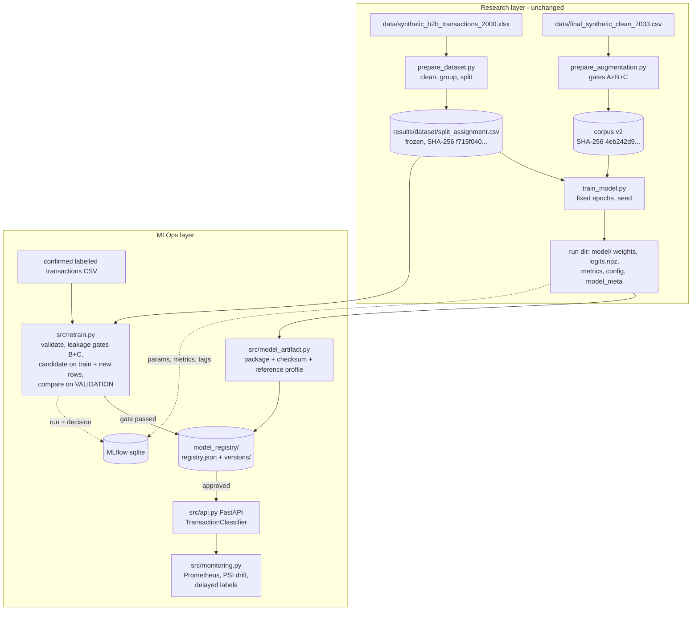

# Architecture

Two layers live in this repository:

1. **Research layer** (unchanged): data preparation, label-free grouping, frozen
   leakage-safe split, gated augmentation corpus v2, fine-tuning of GermanFinBERT /
   FinBERT across five seeds, temperature-scaling experiment, final evaluation. See
   `PROJECT_INDEX.md` and `FINAL_REPORT.md`.
2. **MLOps layer** (added Nov 2026): model packaging and registry, MLflow tracking,
   FastAPI inference, monitoring, gated retraining, Docker and CI. It **reuses** the
   research code (preprocessing, frozen split loader, training loop, evaluation,
   inference, augmentation gates) rather than re-implementing it.

## Data and model flow

## Inference path

`TransactionClassifier` (research `src/inference.py`) applies the exact research
preprocessing (`clean_description` with the run's `PreprocessingConfig`), tokenises
with the run's tokenizer and `max_length`, computes softmax probabilities and routes:
confidence ≥ 0.80 → `automatic`, else `manual_review`. Probabilities are
uncalibrated, matching the primary research result (temperature scaling did not
generalise). The only change to this module is a `predict_proba` method that the
existing `predict` now calls; its output is unchanged.

## Registry

`model_registry/versions/<id>/` contains `model/` (safetensors weights + tokenizer),
the run's `config.json`, `label_mapping.json`, `model_meta.json`, validation/test
metrics, `category_parents.json`, `train_vocabulary.json`, `reference_profile.json`
and `metadata.json` (version, base checkpoint + pinned revision, seed, split and
corpus checksums, metrics, environment, git commit, weights SHA-256). The API refuses
to serve a version whose weights checksum does not match. `registry.json` holds the
approved pointer, history and an event log of every decision. Weights are never
committed to git.

## Security and privacy

* No credentials are required anywhere; `.env` is git-ignored; `.env.example` lists
  only non-secret settings.
* Request bodies are never logged; validation errors do not echo the input.
* The monitoring log stores numeric buckets only (length, token count, unseen-token
  share, digit share) plus the prediction; never the description.
* Weights are loaded from safetensors; `.bin` (pickle) checkpoints are rejected by
  the packager. Saved logits are read with `allow_pickle=False`.
* Containers run as an unprivileged user; the registry is mounted read-only.
